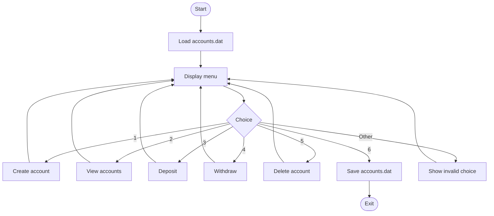

# 🏦 Bank Management System in C

<div align="center">

**A terminal-based account management demonstration written in standard C.**

  

</div>

> [!WARNING]
> **Educational use only.** This program is not a banking service and must never be used with real personal or financial data. It has no authentication, authorization, encryption, reliable input validation, transaction ledger, or robust recovery.

## ✨ Implemented features

| Feature | Current behaviour |
|---|---|
| 🆕 Create account | Adds account number, name, and initial balance to memory. |
| 📋 View accounts | Displays all active records. |
| 💰 Deposit | Adds the entered amount to the first matching account. |
| 💸 Withdraw | Subtracts the amount if the balance comparison succeeds. |
| 🗑️ Delete | Removes the first matching record by shifting array entries. |
| 💾 Save | Writes records to `accounts.dat` when Exit is selected. |
| 📂 Load | Reads up to 100 structures at startup. |

## 🧰 Technology and design

- C with standard headers: `stdio.h`, `stdlib.h`, `string.h`.
- One source file: `bank management system/main.c`.
- A fixed global array of 100 `Account` records.
- Local raw binary persistence through `fread` and `fwrite`.
- A numbered terminal menu, no network or database service.

## 🚀 Build and run

Install GCC or Clang, then run these commands from the repository root.

**Windows PowerShell**
```powershell
Set-Location '.\bank management system'
gcc -std=c11 -Wall -Wextra -Wpedantic -O2 main.c -o bank-management-system.exe
.\bank-management-system.exe
```

**Linux / macOS**
```bash
cd "bank management system"
gcc -std=c11 -Wall -Wextra -Wpedantic -O2 main.c -o bank-management-system
./bank-management-system
```

The checked-in `main.exe` is a prebuilt artifact. Rebuilding from source is preferred. The program resolves `accounts.dat` relative to its process working directory, not necessarily the executable location.

## 🧭 Menu

| Choice | Operation | Function |
|---|---|---|
| 1 | Create Account | `createAccount()` |
| 2 | View Accounts | `viewAccounts()` |
| 3 | Deposit Money | `depositMoney()` |
| 4 | Withdraw Money | `withdrawMoney()` |
| 5 | Delete Account | `deleteAccount()` |
| 6 | Exit and save | `saveAccounts()` |

## 🔄 Application flow



More editable diagrams are in [docs/diagrams](docs/diagrams/README.md).

## 🗂️ Repository structure

```text
.
├── .github/                 # Issue templates, PR template, CI workflows
├── bank management system/  # C source and existing Windows executable
├── docs/                    # Detailed guides, diagrams, ADRs, runbooks
├── CHANGELOG.md
├── CODE_OF_CONDUCT.md
├── CONTRIBUTING.md
├── GOVERNANCE.md
├── LICENSE
├── MAINTAINERS.md
├── README.md
├── ROADMAP.md
├── SECURITY.md
└── SUPPORT.md
```

See [the detailed project structure](docs/project-structure.md).

## 📚 Documentation index

| Guide | Purpose |
|---|---|
| [Documentation hub](docs/README.md) | Complete guide index and reading paths |
| [Project overview](docs/project-overview.md) | Goals, scope, and terminology |
| [Architecture](docs/architecture.md) | Program structure and runtime relationships |
| [System design](docs/system-design.md) | Current design and proposed separation |
| [Project structure](docs/project-structure.md) | Repository tree and file responsibilities |
| [Workflow](docs/workflow.md) | Startup, menu, and exit lifecycle |
| [Features](docs/features.md) | Detailed behaviour of each operation |
| [Installation](docs/installation.md) | Compiler setup and build commands |
| [Configuration](docs/configuration.md) | Working directory and build configuration |
| [Usage](docs/usage.md) | Step-by-step menu guide |
| [Interface reference](docs/api.md) | Menu and function reference, no HTTP API exists |
| [Data storage](docs/database.md) | Structure layout and binary persistence |
| [Data flow](docs/data-flow.md) | Input, memory, and file movement |
| [Modules](docs/modules.md) | Logical function responsibilities |
| [Components](docs/components.md) | Current components and proposed boundaries |
| [Testing](docs/testing.md) | Manual test matrix and future automated strategy |
| [Deployment](docs/deployment.md) | Safe educational packaging |
| [Security](docs/security.md) | Source-grounded risks and remediation |
| [Accessibility](docs/accessibility.md) | Terminal interaction considerations |
| [Performance](docs/performance.md) | Complexity and realistic constraints |
| [Limitations](docs/limitations.md) | Known design and operational gaps |
| [Future scope](docs/future-scope.md) | Prioritized evolution plan |
| [Glossary](docs/glossary.md) | Project terminology |
| [References](docs/references.md) | Language and tooling references |
| [FAQ](docs/faq.md) | Common questions |
| [Troubleshooting](docs/troubleshooting.md) | Build, input, and persistence issues |
| [Development](docs/development.md) | Contribution workflow and standards |
| [ADRs](docs/adr/README.md) | Recorded design decisions |
| [Runbooks](docs/runbooks/README.md) | Local demo procedures |

## ⚠️ Known limitations

1. The account array has a fixed capacity of 100.
2. Duplicate account numbers are allowed and operations use the first match.
3. Numeric `scanf` calls are unchecked.
4. The name scanset has no field-width limit for a 50-byte destination, creating a buffer-overflow risk.
5. Negative initial balances and transaction amounts are not rejected.
6. Money is stored as `float`, which is unsuitable for exact currency accounting.
7. The binary file is unencrypted, unversioned, and compiler-layout dependent.
8. Data is saved only when the user selects Exit.
9. File write/close completion is not fully verified.
10. There is no authentication, authorization, audit history, multi-user model, or recovery strategy.

These are meaningful correctness and safety problems, not cosmetic issues. Read [SECURITY.md](SECURITY.md) before running or sharing this project.

## 🧪 Verification

The repository includes compiler CI for GCC and Clang plus a documentation presence check. A successful build does not prove financial correctness or security. See [testing strategy](docs/testing.md).

## 🤝 Contributing

Use synthetic test values, compile with strict warnings, add reproducible test steps, and update docs and diagrams when behaviour changes. Read [CONTRIBUTING.md](CONTRIBUTING.md).

## 📜 License

MIT. See [LICENSE](LICENSE).

<div align="center">Built as a C programming project by Brajesh Kumar. ⭐ If it helped you learn C structures, arrays, functions, or file I/O, consider starring the repository.</div>

Last updated: 2026-11-19 23:24 UTC
