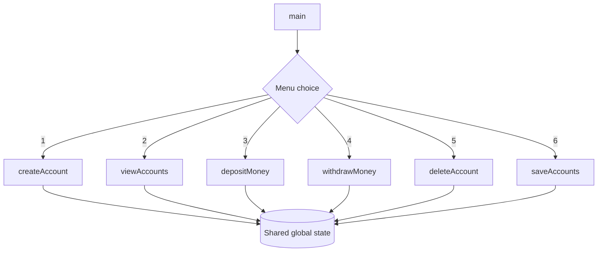
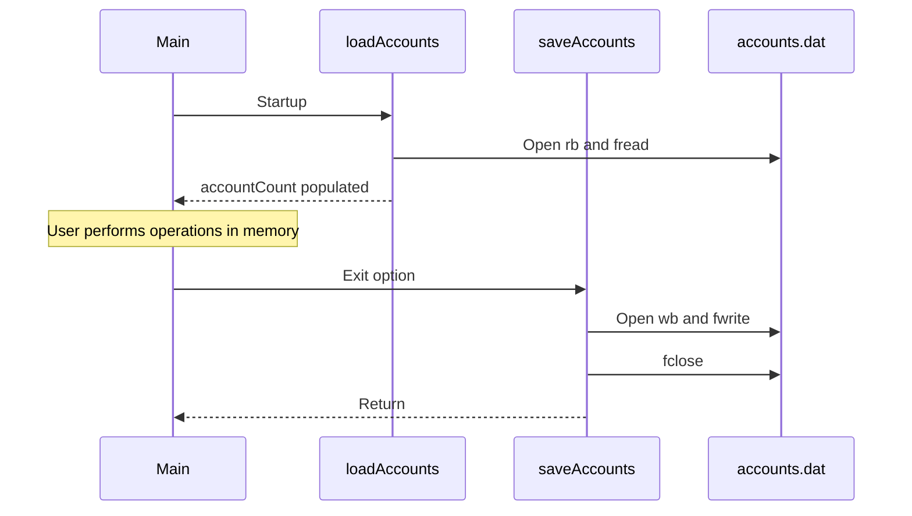

# 🏗️ Architecture

## 1. Overview

The current application is a single-process C console program. It is implemented in `bank management system/main.c` and uses the standard C runtime for terminal I/O and local file operations.

The architecture is deliberately small:
- a menu loop in `main` controls the program lifecycle;
- a global fixed-size array stores account records in memory;
- operation functions read user input and mutate or display that state;
- persistence functions load and save raw structure records.

There is no network layer, server process, database service, authentication provider, or graphical user interface.

## 2. Runtime topology

```mermaid
flowchart TB
    User[Terminal user] -->|Menu selection and values| Main[main]
    Main -->|Dispatch| Ops[Account operation functions]
    Ops <--> State[(accounts[100] and accountCount)]
    Main --> Load[loadAccounts]
    Load -->|fread| Data[(accounts.dat)]
    Main --> Save[saveAccounts]
    Save -->|fwrite| Data
    Main -->|printf output| User
```

## 3. Main program responsibilities

### Entry point
`main` calls `loadAccounts` once before entering a `do...while` loop. Each iteration prints the menu, reads a choice, and dispatches through a `switch`. The Exit branch calls `saveAccounts` and then allows the loop to end.

### In-memory state
`accounts` is a global array of 100 `Account` structures. `accountCount` describes the active prefix. All operation functions access this state directly.

### Domain operations
Creation appends a record; view prints active entries; deposit and withdrawal search by integer account number and mutate a balance; deletion removes an entry by shifting the following elements.

### Persistence
The loader reads up to 100 structures from a relative binary file. The saver truncates/creates the file and writes the active structures. Neither function defines a portable serialization protocol.

## 4. Data structure

```c
typedef struct {
    int accountNumber;
    char name[50];
    float balance;
} Account;
```

The record mixes an integer identifier, a fixed character array, and a floating-point balance. The structure is copied and serialized as a unit.

## 5. Control flow and operation coupling



The coupling is intentional in the current beginner example, but it makes unit testing operations in isolation difficult. A future refactor should pass an account collection or service object explicitly.

## 6. Persistence boundary



The current format is not versioned, encrypted, or portable. It is vulnerable to incompatibility when the structure layout changes.

## 7. Failure handling

The code handles a missing data file by returning from the loader. It handles a failed save-file open by printing an error. Not-found accounts and insufficient withdrawal balance also produce messages.

However, input conversion results, short reads/writes, close errors, invalid stored fields, and duplicate identifiers are not comprehensively handled.

## 8. Proposed separation of concerns

A safer future architecture could divide the application into:
1. presentation and menu routing;
2. bounded input parsing;
3. account-domain rules;
4. persistence and serialization;
5. automated tests.

This is a target design only. Do not infer that separate modules exist in the current repository.
