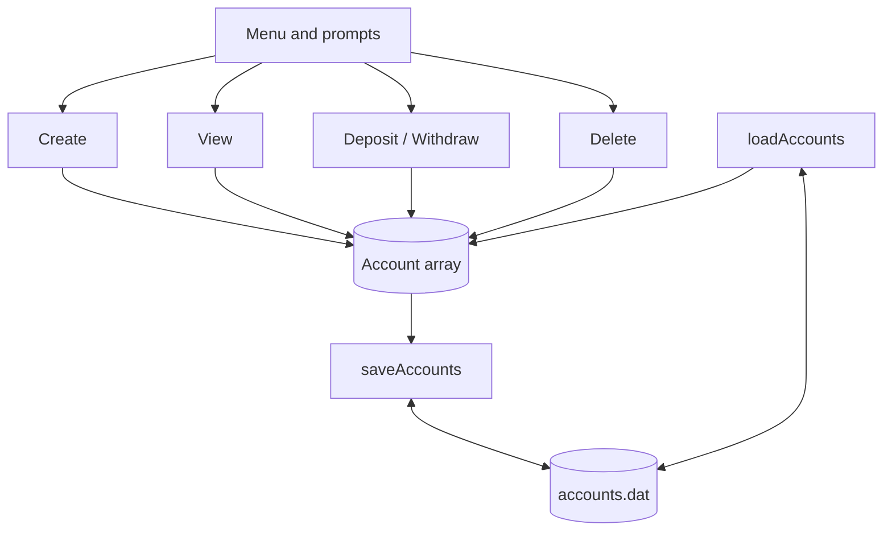

# 🧩 Component catalogue

## 1. Menu and control loop

Implemented in `main`. It prints a numbered menu, reads a choice, dispatches through a switch, and repeats until option 6 is selected.

## 2. Account record

The `Account` structure groups an integer account number, a 50-byte character buffer, and a `float` balance. No constructor, validator, account status, or ownership metadata exists.

## 3. In-memory collection

The global `accounts[100]` array stores all active records. `accountCount` identifies the active prefix. The code assumes the count remains inside the array bounds.

## 4. Operations

Creation, listing, deposit, withdrawal, and deletion are direct functions over global state. Search logic is repeated rather than centralized in a reusable lookup function.

## 5. Persistence

`loadAccounts` and `saveAccounts` read and write raw structures using C standard I/O. No database integration is present.

## Component diagram

## Future boundary

A maintainable revision should isolate presentation, validated input, domain rules, and persistence. That separation would improve testability and make it easier to replace the raw binary file format. It should be introduced with tests, not merely represented by documentation.
