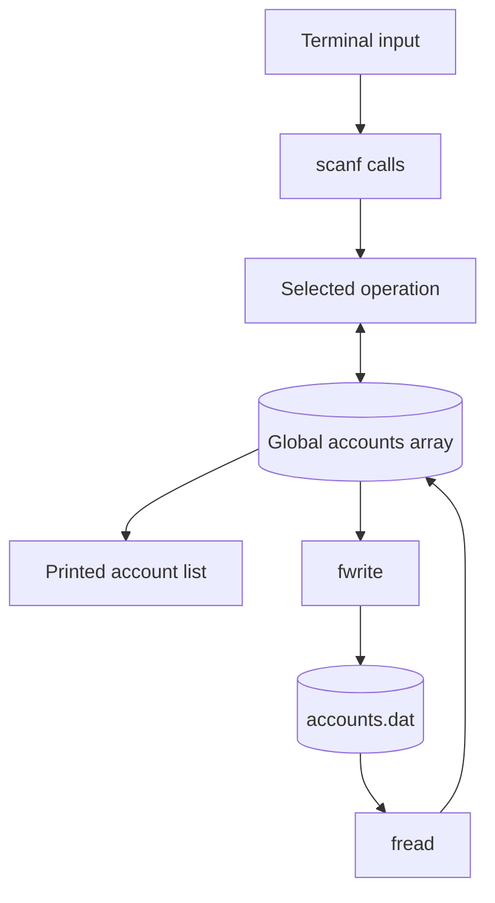
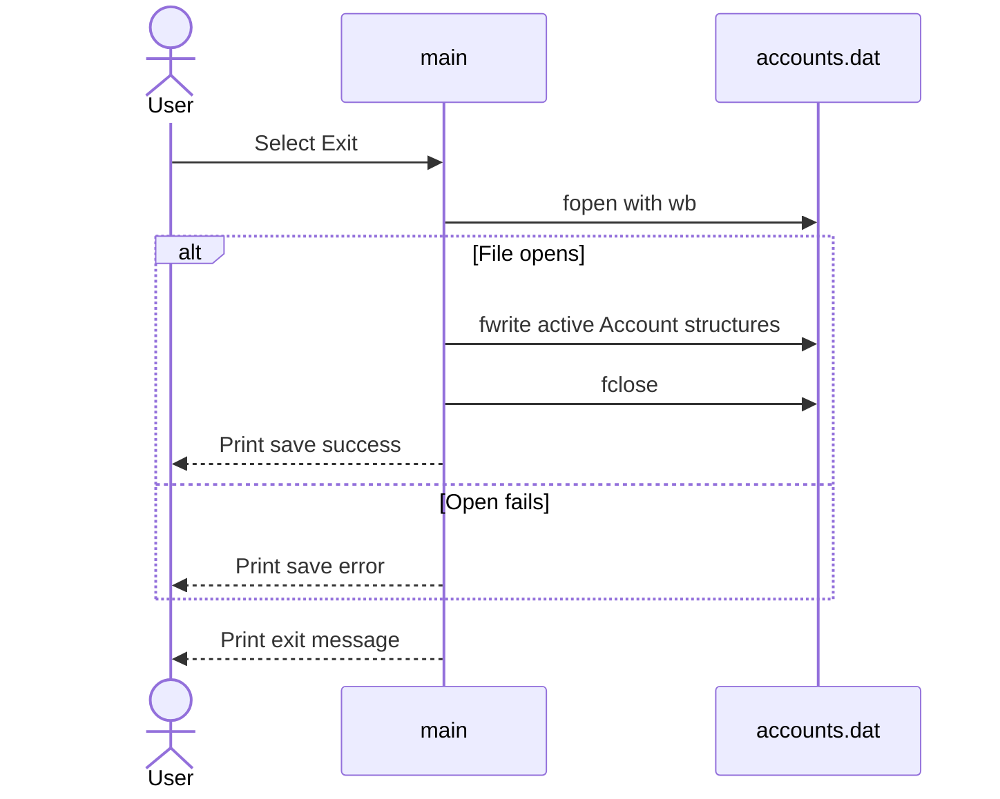

# 🔀 Data flow

## Current path

User values are read inside operation functions using `scanf`. Those values are either copied into the global array or used to mutate an existing balance. The view operation reads directly from the array. The save function serializes the active array range to the local binary file.



## Account creation sequence

```mermaid
sequenceDiagram
    actor User
    participant Main
    participant Create as createAccount
    participant State as accounts array
    User->>Main: Choose option 1
    Main->>Create: Invoke function
    Create->>User: Prompt for number, name, initial balance
    User-->>Create: Enter values
    Create->>State: Copy Account into next array slot
    Create->>State: Increment accountCount
    Create-->>Main: Return to menu
```

## Deposit and withdrawal

Both functions scan the active array from the start. They mutate the first matching record. Neither function creates a separate transaction record, so the program cannot show historical deposits or withdrawals.

## Save sequence



## Data-flow risks

Parsing and validation are not separate stages. A safer implementation should read a bounded line, parse it with checked conversion, validate the domain range, and only then mutate state. Persistence should validate records on load and verify every I/O result on save.
