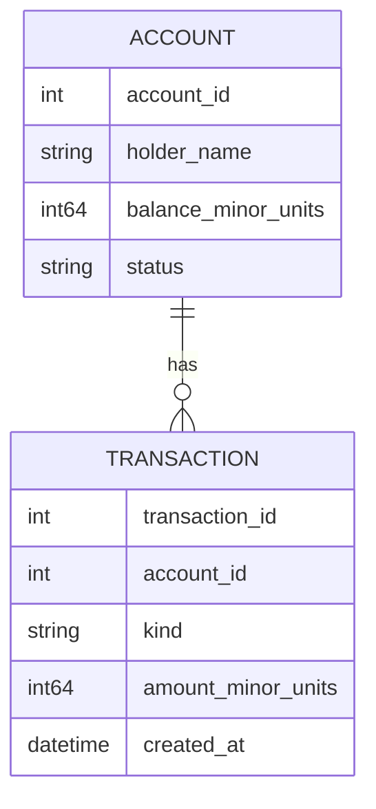

# 💾 Data model and file persistence

## There is no database server

The banking theme does not imply a database integration. The current program uses a global C array and writes raw structures to a local file named `accounts.dat`. It does not connect to SQL or a remote service.

## Account structure

```c
typedef struct {
    int accountNumber;
    char name[50];
    float balance;
} Account;
```

| Field | Type | Purpose | Current validation |
|---|---|---|---|
| `accountNumber` | `int` | Lookup key | Parsed without checking conversion success; duplicates allowed |
| `name` | `char[50]` | Display name | Unbounded scanset read can overflow |
| `balance` | `float` | Current displayed balance | Negative and unsuitable precision values are not rejected |

## Save algorithm

1. Call `fopen("accounts.dat", "wb")`.
2. If opening fails, print an error and return.
3. Call `fwrite` for `accountCount` structures.
4. Close the stream.
5. Print a success message.

The return values from `fwrite` and `fclose` are not checked. The `wb` mode truncates any previous contents when the file is opened.

## Load algorithm

1. Open the relative file with `rb`.
2. If open fails, return without loading records.
3. Read up to 100 `Account` objects into the global array.
4. Store the number read in `accountCount`.
5. Close the stream.

## Format limitations

Raw structure storage depends on integer and floating-point representations, structure padding, compiler ABI, architecture, and future structure changes. There is no version marker, checksum, explicit record count header, encryption, or data migration strategy. Treat the file as disposable synthetic data.

## Proposed future model



This is a target model only. The current code has no transaction entity or transaction history.
