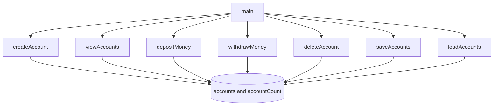

# 🧱 Logical module catalogue

All current functions live in one translation unit. The labels below describe logical responsibilities, not separate `.c` or `.h` files.

| Area | Current functions/symbols | Responsibility |
|---|---|---|
| Entry and navigation | `main` | Startup, menu loop, dispatch, save and exit |
| Creation | `createAccount` | Read fields and append a record |
| Presentation | `viewAccounts` | Print active records |
| Balance operations | `depositMoney`, `withdrawMoney` | Search and mutate a balance |
| Record lifecycle | `deleteAccount` | Remove a record and compact the array |
| Persistence | `saveAccounts`, `loadAccounts` | Raw binary file write/read |
| Shared state | `accounts`, `accountCount` | Store the active records |

## Dependency map



## Coupling and testing implications

The global array is an implicit dependency for every operation. Unit testing a function requires controlling process-wide state. A future refactor could move domain operations into a module that receives an account collection explicitly, and move file logic behind a storage interface.

## Possible future source layout

```text
src/
├── main.c
├── account.h
├── account.c
├── input.h
├── input.c
├── storage.h
└── storage.c
tests/
├── test_account.c
└── test_storage.c
```

This is a proposal. Do not treat these modules as present until the application is actually refactored and built.
