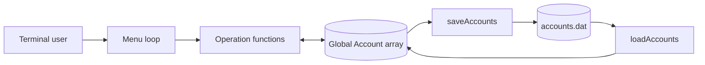
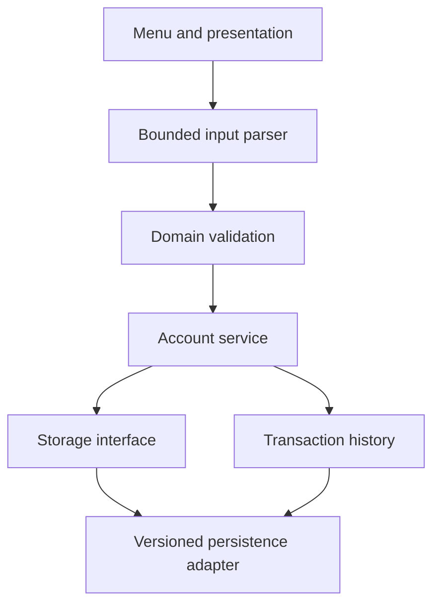

# 🧩 System design

## Current implementation

The current architecture has three practical pieces: a terminal-driven control loop, a shared in-memory account array, and a local binary file. All source logic is contained in `main.c`.

### State ownership

The global `accounts` array and `accountCount` variable are shared across all functions. Each operation reads or mutates that state directly. This makes the example compact, but it hides dependencies and makes independent unit testing harder.

### Record lookup

Deposit, withdrawal, and deletion perform a linear scan and compare the integer account number. Account creation does not enforce uniqueness, so duplicates can cause an operation to update or remove the first occurrence rather than an unambiguous record.

### Persistence boundary

`saveAccounts` opens the file with `wb`, which truncates the prior file, then writes raw `Account` values. `loadAccounts` reads at most 100 structures. There is no format version, explicit schema, checksum, or portable encoding.

## Current trade-offs

| Choice | Advantage | Cost |
|---|---|---|
| Single translation unit | Easy to compile and inspect | Responsibilities are tightly coupled |
| Global fixed array | Simple beginner example | Fixed capacity and shared mutation |
| Linear lookup | Easy to explain | O(n) lookup |
| Raw binary dump | Minimal code | ABI and compiler dependence |
| `float` balance | Simple arithmetic | Not exact currency representation |
| Save on exit | Simple lifecycle | Unsaved changes can be lost |

## Proposed target separation

The target is a recommendation, not existing application code. A responsible refactor would first add input validation and tests, then separate domain rules from terminal I/O and storage. Monetary values should use integer minor units, and persistence should validate a defined versioned format.
