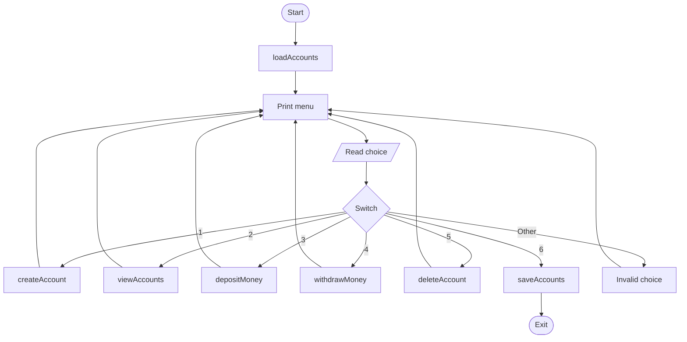

# 🔄 Runtime workflow

## Startup sequence

1. The operating system launches the executable.
2. `main` initializes its local menu-choice variable.
3. `loadAccounts` attempts to open `accounts.dat` in binary read mode.
4. The menu is printed and a numeric choice is read.
5. The `switch` statement dispatches to the selected operation.
6. Choices 1 through 5 return to the menu loop.
7. Choice 6 calls `saveAccounts`, prints the exit message, and ends the loop.

## Menu flowchart

## Persistence timing

Mutations are made in memory. The current application does not save after each operation. It attempts to save only on the explicit Exit path. A crash or forced termination before Exit can discard changes from that session.

## Failure paths

- A missing or unopenable file at startup results in the loader returning without loading records.
- An account lookup with no match prints an account-not-found message.
- A withdrawal that fails the balance comparison prints an insufficient-funds message.
- A failed save-file open prints an error, but short writes and close errors are not checked.
- Malformed input is not safely recovered because `scanf` return values are ignored.
